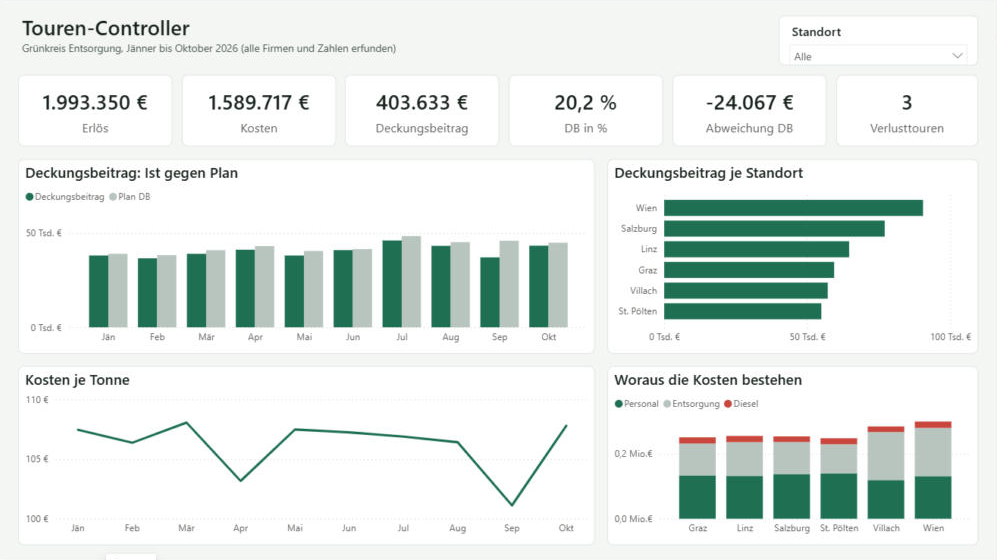
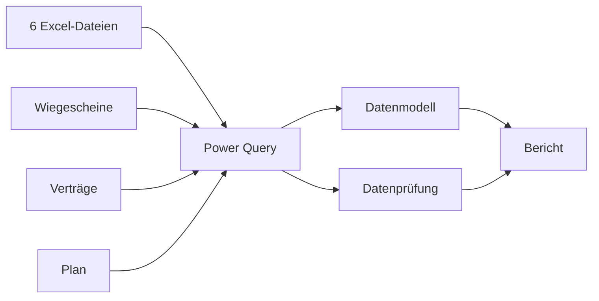
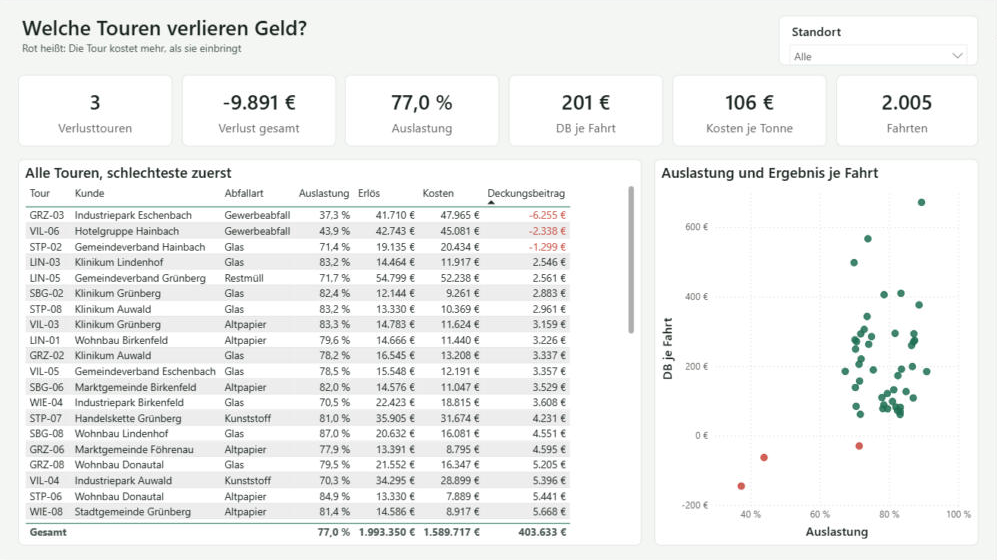
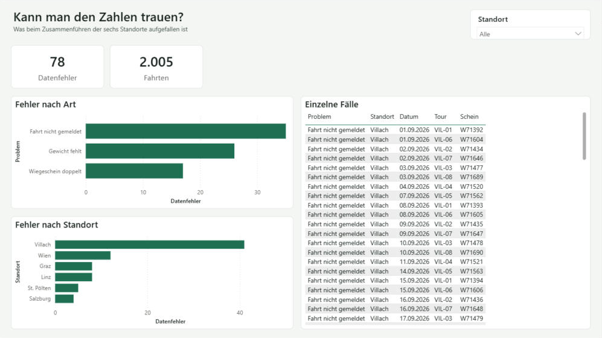

# Touren-Controller

Ein Power-BI-Bericht für eine Entsorgungsfirma: Welche Touren bringen Geld, welche kosten Geld, und kann man den Zahlen trauen?

Alle Firmen, Kunden und Zahlen sind erfunden.

## Das Problem

Sechs Standorte schicken jeden Monat ihre eigene Excel-Liste. Jede sieht anders aus: andere Spaltennamen, Titelzeilen, Datum als Text, Stunden als `7:30`, Kilometer mit Einheit, Diesel einmal brutto. Dazu kommen Wiegescheine als CSV, Verträge mit Preiserhöhungen und ein Plan im Querformat. Von Hand zusammenkopiert kostet das Zeit und macht Fehler.

## Die Lösung

- **Power Query** vereinheitlicht alle Quellen. Welche Spalte wie heißt, steht in einer Tabelle (`daten/spalten.csv`). Ein neuer Standort braucht nur neue Zeilen darin, keine neue Formel.
- **Datenmodell** als Sternschema: Fahrten in der Mitte, dazu Kalender, Standorte und Touren. Der Plan hängt an denselben Tabellen.
- **19 Kennzahlen** in DAX, jede mit Erklärung.
- **Datenprüfung** als eigene Seite, damit niemand falschen Zahlen glaubt.

## Was herauskommt

| Erkenntnis | Empfehlung |
|---|---|
| Graz 03 verliert 6.255 €, der LKW ist nur zu 37 % ausgelastet | Tour mit einer anderen zusammenlegen |
| Villach 06 verliert 2.338 € bei 44 % Auslastung | ebenso |
| St. Pölten 02 verliert 1.299 € trotz 71 % Auslastung, lange Strecke und keine Preiserhöhung im Juli | Vertrag neu verhandeln |
| Villach hat im September keine Fahrten gemeldet | erst nachfordern, dann die Abweichung zum Plan bewerten |

## Öffnen

1. [Power BI Desktop](https://www.microsoft.com/de-de/power-platform/products/power-bi/desktop) installieren (kostenlos).
2. `Touren-Controller.pbip` öffnen.
3. Unter „Daten transformieren“, „Parameter bearbeiten“ bei `Ordner` den Pfad zum Ordner `daten` eintragen.
4. „Aktualisieren“ klicken. Fragt Power BI nach Sicherheitsstufen, für die Dateien „Organisation“ wählen.

## Geprüft

Die Rohdaten erzeugt `werkzeug/rohdaten.py`. Dabei entsteht `werkzeug/soll.json` mit den richtigen Ergebnissen. Fahrten, Erlös, Kosten, Deckungsbeitrag je Standort, Verlusttouren und Datenfehler im Bericht stimmen damit überein.

## Grenzen

- Die Verträge kommen aus einer CSV-Datei. In einer Firma käme hier eine Datenbank oder SharePoint.
- Der Bericht läuft in Power BI Desktop, eine automatische Aktualisierung im Power BI Service ist nicht eingerichtet.
- Der Deckungsbeitrag enthält Diesel, Personal und Entsorgung, aber keine Fahrzeugkosten.
